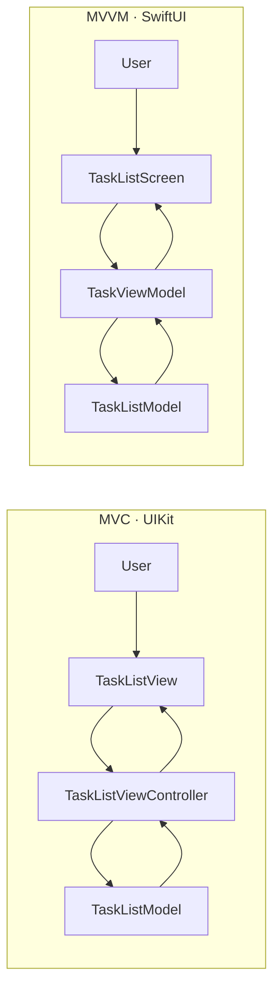

# Lab 4A: MVC and MVVM

This submission includes two implementations of the same task-list workflow. The MVC version uses UIKit; the MVVM version uses SwiftUI. Both share the same model rules for adding, completing, deleting, and filtering tasks.

## Requirements

| Requirement | Implementation |
|---|---|
| R1: Add, complete, delete, and filter tasks | Both screens support all four operations. New titles are trimmed; blank titles are rejected. |
| R2: MVC with model, view, and controller | `TaskListModel` contains task rules; `TaskListView` lays out UIKit controls; `TaskListViewController` connects user actions to the model and renders updates. |
| R3: MVVM with model, view-model, and view | `TaskItem` / `TaskListModel` hold data and rules; `TaskViewModel` exposes state and actions; `TaskListScreen` renders the state in SwiftUI. |
| R4: Keep filtering and validation out of the UI | The model validates and filters. The view-model forwards commands and exposes filtered tasks. The views only collect input and display results. |
| R5: Compare testability and wiring | See the comparison below. The package's XCTest target exercises view-model behavior without launching either UI. |

## Architecture



Both screens use the shared `TaskListCore` model so validation, filtering, and task mutations behave consistently.

## Comparison

| Aspect | MVC | MVVM |
|---|---|---|
| Responsibilities | The controller coordinates view events, model operations, and rendering. | The view-model exposes display state and commands; the view binds to that state. |
| Testability | Model rules can be tested independently; controller behavior typically needs UIKit or a separate coordinator seam. | View-model commands and visible-task filtering are testable without creating a SwiftUI view. |
| UI wiring | UIKit targets, table data-source/delegate methods, and explicit reloads are required. | SwiftUI state observation updates the view; list and picker bindings provide most of the wiring. |
| Best fit in this example | Shows explicit control and familiar UIKit delegation. | Keeps the screen declarative and makes presentation behavior straightforward to unit test. |

## UI previews

The two SVGs in `screenshots/` are illustrative screen mockups, not captures from a running iOS simulator. This workspace runs on Windows and does not have UIKit, SwiftUI, or the iOS Simulator available, so native runtime screenshots could not be captured here. Replace or supplement these previews with simulator screenshots when opening the package on macOS.

## Run the unit tests

From this directory, run:

```sh
swift test
```

The test target covers whitespace validation and trimming, completion toggling, filtering, and deletion. It imports only the core module and does not launch a UI.
